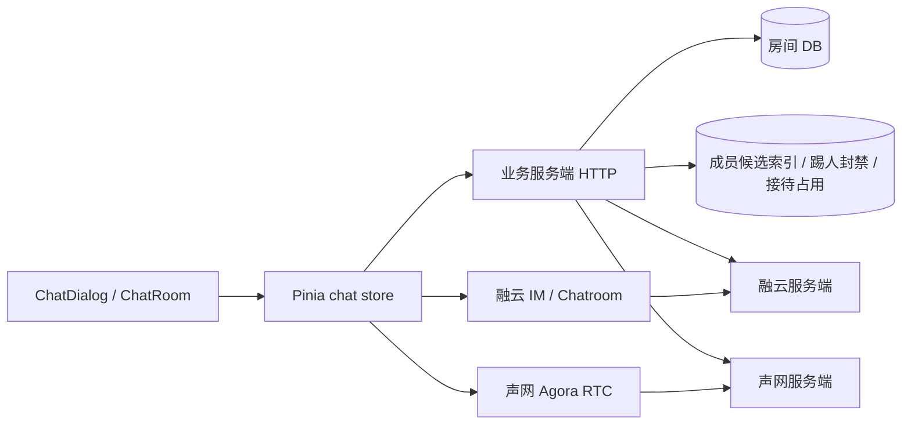
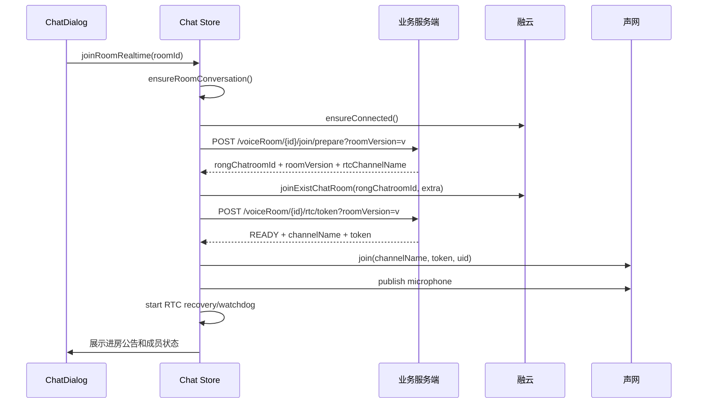

# PC 端语音房实现说明

> 适用代码：`/Users/yucheng/Desktop/盼之电竞/pzdj-pc`
>
> 整理时间：2026-10-18

## 1. 功能定位

PC 端语音房是一个常驻在全局聊天弹窗中的实时房间。它同时提供：

- 房间成员列表和成员角色（房主、接待、大神）；
- 融云聊天室文字消息、成员进出事件和业务信令；
- 声网 RTC 语音连麦、麦克风状态和说话状态；
- 邀请好友进入房间、呼叫俱乐部接待、客服派单和踢人；
- 切换路由、收起聊天弹窗、网络断开后继续维护或恢复实时连接。

房间的业务状态由 `pzdj-service` 管理，PC 端不直接把浏览器本地状态当成最终事实。进入、退出、RTC 准入和房间实例变化均以服务端校验结果为准。

## 2. 总体架构



### 2.1 三个系统的职责

| 系统 | 负责内容 | 关键数据 |
| --- | --- | --- |
| 业务服务端 | 创建/关闭房间、房间版本、成员候选索引、角色和权限、RTC Token | `roomId`、`roomVersion`、`roomStatus`、`clubId`、`serviceUserId` |
| 融云 IM | 私聊、房间文字消息、聊天室成员事件、客服/踢人/匹配等命令 | `rongChatroomId`、消息 `messageUId`、命令 `name/data` |
| 声网 RTC | 麦克风采集、远端音频播放、RTC 在线、开麦、说话指示 | `rtcChannelName`、Agora UID、RTC Token |

PC 端封装位置：

- `stores/chat.ts`：房间状态、业务流程和实时链路编排；
- `composables/useSso.ts`：业务服务端接口和 DTO；
- `composables/useRc.ts`：融云连接、聊天室、消息和邀请链接；
- `composables/useRtc.ts`：声网 SDK 原子操作；
- `composables/useRtcRecovery.ts`：RTC Token 续期、断线恢复和 Watchdog；
- `composables/useRoomLeave.ts`：离开/解散二次确认和统一出口。

## 3. 页面和状态模型

### 3.1 全局挂载

`layouts/default.vue` 挂载 `ChatFloatingHost`，`ChatFloatingHost` 常驻 `ChatDialog`。收起聊天弹窗只修改 `uiStore.chatVisible`，不会卸载房间组件，因此不会因为路由切换或弹窗收起而断开 IM/RTC。

`uiStore.chatView` 保存当前视图：

- `type: chat-room`：展示语音房；
- `id`：业务房间 ID；
- `v`：邀请链接携带的房间实例版本；
- `initial`：深链/刷新首次进入标记。

相关文件：`pzdj-pc/stores/ui.ts`、`pzdj-pc/components/chat/ChatFloatingHost.vue`、`pzdj-pc/components/chat/ChatDialog.vue`。

### 3.2 Chat Store 核心状态

`stores/chat.ts` 中的 `VoiceRoom` 是页面运行时模型，主要字段如下：

| 字段 | 作用 |
| --- | --- |
| `id` | 业务房间主键，固定房间重新开启时可复用 |
| `roomVersion` | 当前开启实例版本，每次重开递增；所有异步操作都要带上它 |
| `rongChatroomId` | 当前融云聊天室 ID |
| `rtcChannelName` | 当前声网频道名 |
| `roomStatus` | `1` 表示开启，`0` 表示关闭 |
| `creatorUserId` | 房主 ID |
| `clubId` / `serviceUserId` | 接待俱乐部和当前接待客服 |
| `members` | 由融云成员列表/服务端资料组成的页面成员列表 |
| `rtcOnlineUserIds` | 声网频道内在线用户 |
| `rtcMicOpenUserIds` | 已发布音频的用户 |
| `rtcSpeakingUserIds` | 正在说话的用户 |
| `rtcPresenceReady` | RTC 首次全量快照是否完成；未完成时不显示“断连” |

`roomId + roomVersion + rongChatroomId + rtcChannelName + userId` 共同构成 RTC 会话实例栅栏。旧房间的异步回调不能写入新房间状态。

### 3.3 房间 UI

`ChatRoom.vue` 分为两列：

- 左侧：`RoomHeader`、`MessageList`、`VoiceRoomBar`；
- 右侧：`MemberGrid`、`VoiceDeviceBar`。

用户点击成员卡片后打开 `RoomMemberPopup`，房主或当前接待可以踢普通成员。邀请按钮复制带版本的链接；房间消息和好友私聊共用融云消息归一化逻辑。

## 4. 创建、进入和恢复流程

### 4.1 创建房间

入口调用 `chatStore.enterVoiceRoom(roomName)`：

1. 检查登录态。
2. 调用 `POST /client/v1/voiceRoom/joined/current` 查询用户当前实际所在房间。
3. 如果已有房间，恢复该房间并打开 `chat-room` 视图。
4. 如果没有房间，调用 `POST /client/v1/voiceRoom/create`。
5. 将服务端返回的 `VoiceRoomData` 映射为 `activeRoom`，设置 `activeRoomId` 和 `voiceRoomOnline`。
6. 打开全局聊天弹窗，后续由 `ChatDialog.enterRoom()` 建立实时链路。

服务端为每个创建人保留一条房间主记录。关闭后重开可以复用业务 `roomId`，但会生成新的 `roomVersion`、融云聊天室 ID 和声网频道实例。

### 4.2 通过邀请链接进入

链接格式：

```text
/chat?type=chat-room&id={roomId}&v={roomVersion}
```

流程：

1. `pages/chat/index.vue`/`ChatDialog` 识别深链参数。
2. 若本地没有 `activeRoom`，调用 `POST /client/v1/voiceRoom/{roomId}/detail` 获取房间详情。
3. 校验 `roomStatus === 1` 和链接中的 `roomVersion`；版本不一致时提示邀请已失效。
4. 设置 `activeRoom` 后进入统一实时进房流程。

### 4.3 统一实时进房顺序

`chatStore.joinRoomRealtime(roomId)` 的顺序不能打乱：



`prepare` 返回的房间快照必须直接用于后续融云入房，不能继续使用旧详情缓存，避免房间重开后版本错配。RTC Token 接口同时校验：房间仍开启、版本一致、用户没有被踢、用户仍在融云聊天室。

### 4.4 刷新和跨路由恢复

- `restoreJoinedRoom()`：没有 `activeRoom` 时查询 `joined/current`，恢复房间卡片和房间状态。
- `isRoomRealtimeActive()`：不能只看服务端“仍在房间”，还要检查本地融云聊天室和声网连接是否真的在线。
- `sessionStorage` 的 `pzdj:leftRoom` 用于阻止主动离开后切回页面时自动重入；用户主动创建/进入时会清除该标记。

## 5. 两条实时链路

### 5.1 融云 IM/聊天室

`useRc.ts` 约定：业务用户 ID直接作为融云用户 ID，`rongChatroomId` 作为聊天室频道，不与业务 `roomId` 混用。

融云负责：

- 房间文字和图片消息；
- 聊天室加入/退出/成员变更事件；
- 房间邀请、自定义接待邀请、踢人通知等命令消息；
- 通过 `messageUId` 去重消息；
- 跨账号登录时断开旧账号连接。

加入聊天室时透传：

```json
{"roomId":"业务房间ID","roomVersion":"实例版本"}
```

服务端使用该信息维护 Redis 成员候选索引。Redis 只是反查候选，最终是否在房间以融云成员关系为准。

### 5.2 声网 RTC

`useRtc.ts` 使用 `agora-rtc-sdk-ng`，创建 `mode: rtc`、`codec: vp8` 的客户端。当前模式所有进房用户均为 publisher，进房后默认可互相说话；代码注释说明未来再评估 `live + host/audience` 麦位模型。

RTC 层负责：

- 加入/离开频道；
- 创建、发布、销毁麦克风轨道；
- 订阅远端音频；
- 静音、麦克风音量、播放音量和设备切换；
- `user-published`/`user-unpublished` 映射为远端开麦状态；
- 采样音量并输出说话用户列表；
- 连接状态、Token 即将过期和异常事件。

RTC 状态只表达“语音链路事实”，不替代融云成员列表。成员卡片是否存在由融云成员决定；卡片上的断连、麦克风和说话标记由 RTC 状态决定。

## 6. 退出、解散和踢人

### 6.1 普通成员离开

`useRoomLeave.confirmLeave()` 二次确认后调用 `chatStore.leaveRoom()`：

1. 停止 RTC Recovery/Watchdog；
2. 退出融云聊天室；
3. 调用 `POST /voiceRoom/{roomId}/leave?roomVersion=v` 清理服务端成员索引；
4. 离开声网频道；
5. 清空本地房间、会话和 RTC presence；
6. 写入 `pzdj:leftRoom`，防止刷新后误重入。

### 6.2 房主解散

房主执行 `POST /voiceRoom/{roomId}/destroy?roomVersion=v`。服务端关闭 DB 房间、清理成员索引、销毁融云聊天室和声网外部资源，并释放接待关系。PC 端请求前先停止恢复器并记录主动解散实例，防止迟到的 RTC/融云事件重复收尾；请求成功后只做本地实时通道退出和状态清理。

### 6.3 踢人

只有房主或当前接待可踢普通成员。`POST /voiceRoom/{roomId}/kickOut` 的服务端顺序为：

1. 踢出声网频道；
2. 写入按 `roomId + roomVersion + userId` 隔离的 60 分钟封禁；
3. 踢出/封禁融云聊天室成员；
4. 清理成员索引；
5. 给被踢用户发送 `ROOM_KICKED` 私聊命令。

PC 端收到命令后只在房间 ID和版本都匹配时清理当前房间。房间关闭后重开会生成新版本，不继承旧版本封禁。

## 7. 接待和试音相关流程

### 7.1 房主呼叫俱乐部接待

房主点击“呼叫接待”后：

1. 前端先展示 `csCalling` 状态并启动 60 秒超时看门狗；
2. 调用 `POST /voiceRoom/inviteClubService`；
3. 服务端找出目标俱乐部在线且空闲的客服，通过融云命令消息弹出接待通知，同时发送持久化卡片用于聊天留痕；
4. 客服点击“接单”调用 `POST /voiceRoom/claimClubService`；
5. 服务端原子占用客服、绑定房间 `serviceUserId` 并返回房间信息和 RTC Token；
6. 客服进入融云聊天室和声网频道；房主收到成员 JOIN 后再调用房间详情确认客服身份，成功后清除 `csCalling`。

客服接单卡片以 `roomId_roomVersion` 去重。接单成功但实时进房失败时，卡片保留“进入房间”恢复入口。

### 7.2 快速匹配试音房

试音房使用 `useQuickMatchRoomFlow.ts`、`useQuickMatch.ts` 和 `quickMatch/auditionRoom/ensure` 领域接口。PC 端负责：

- 抢单/进入前检查当前房间；
- 房主在进行中的试音房不能被通用流程直接解散；
- 切房前重新查询当前房间，避免多端状态变化后误解散；
- 进入失败时保留“已抢单/进入房间”恢复入口。

具体房间创建和试音需求版本由后端领域接口协调，前端只接收最新房间快照并复用统一进房流程。

## 8. RTC 断线恢复

`useRtcRecovery.ts` 是独立恢复协调器，不在底层 SDK 回调中直接改业务房间状态。

### 8.1 触发来源

- 声网最终进入 `DISCONNECTED`；
- 连接长时间停留在 `CONNECTING/RECONNECTING`（60 秒后接管）；
- Token 即将过期/已过期；
- 30 秒 Watchdog；
- 浏览器重新联网、获得焦点、页面重新可见；
- 融云重连成功。

### 8.2 恢复策略

1. 以当前会话快照请求 `/rtc/token`，重新做服务端准入校验。
2. `READY`：调用 `forceRejoinRoom` 重建频道和麦克风，并用 `remoteUsers` 全量快照校准在线状态。
3. `ROOM_CLOSED`、`ROOM_VERSION_CHANGED`、`NOT_IN_CHATROOM`、`KICKED_BANNED`：停止恢复器，交给 Chat Store 统一清理并提示用户。
4. 普通请求异常：不改变房间状态，按 2/5/10/20/30 秒退避重试。
5. Token 即将过期：只调用 `renewToken`，不主动重进频道，减少断音。
6. 麦克风轨道异常但频道仍连接：优先只重建麦克风，不做完整重入。

所有异步恢复任务都带 generation 和完整会话比较，切房/退房后旧请求返回只能静默结束。

## 9. 业务接口清单

接口前缀为 `/client/v1`，均使用业务登录态。

| 接口 | 用途 | 关键说明 |
| --- | --- | --- |
| `POST /voiceRoom/create` | 创建或开启房间 | `roomName`、可选 `clubId` |
| `POST /voiceRoom/joined/current` | 查询当前实际加入的房间 | 无房返回 `null`；服务端会校验融云成员关系 |
| `POST /voiceRoom/{roomId}/detail` | 查询房间详情 | 邀请链接进入、刷新接待绑定 |
| `POST /voiceRoom/{roomId}/join/prepare?roomVersion=v` | 准备入房 | 写成员候选索引并返回最新外部实例 ID |
| `POST /voiceRoom/{roomId}/rtc/token?roomVersion=v` | RTC 准入和 Token | 返回 `READY` 或终止状态 |
| `POST /voiceRoom/{roomId}/leave?roomVersion=v` | 确认离开 | 清理当前用户成员索引 |
| `POST /voiceRoom/{roomId}/destroy?roomVersion=v` | 房主解散 | 关闭房间并销毁外部资源 |
| `POST /voiceRoom/{roomId}/kickOut` | 踢普通成员 | action：`userId`、`roomVersion` |
| `POST /voiceRoom/inviteClubService` | 房主呼叫接待 | action：`roomId`、`clubId`、`roomVersion` |
| `POST /voiceRoom/claimClubService` | 客服接单 | 返回房间信息和客服 RTC Token |
| `POST /voiceRoom/{roomId}/join/kicked?roomVersion=v` | 查询封禁 | 只读检查，真正入房仍需走准入 |

`RtcTokenResult.accessStatus`：

| 状态 | 含义 | PC 处理 |
| --- | --- | --- |
| `READY` | 可以加入声网 | join/forceRejoin |
| `ROOM_CLOSED` | 房间已关闭或不存在 | 退出并提示房间已关闭 |
| `ROOM_VERSION_CHANGED` | 房间已重开 | 清理旧实例，重新获取详情 |
| `NOT_IN_CHATROOM` | 融云成员关系已失效 | 退出本地房间 |
| `KICKED_BANNED` | 当前实例被踢且仍在封禁期 | 退出并禁止立即重入 |

## 10. 移动端复用建议

### 必须保留的业务原则

1. `roomId` 和 `roomVersion` 必须成对传递；所有异步结果校验实例一致性。
2. 融云成员状态和声网 RTC 状态分开建模，不能只用一个“在线”字段。
3. 进 RTC 前必须先经过服务端 `/rtc/token` 准入，不能仅凭房间详情直接进频道。
4. `prepare -> 融云入房 -> RTC 准入 -> RTC join` 顺序保持不变。
5. 主动离开、房主解散、被踢、房间关闭、版本变化走统一清理流程。
6. 断线恢复重新请求 Token；不要用本地缓存 Token 或本地在线标记直接恢复。
7. 退出和切房操作需要幂等、防重入，并能处理多端同时变化。

### 移动端可调整的部分

- 全局弹窗可替换为页面栈或底部房间页，但实时服务生命周期应放在页面外的 Store/Provider 中；
- PC 的鼠标悬浮设备面板改成移动端底部操作面板；
- `VoiceRoomBubble` 在 PC 当前已注释下线，移动端可以根据产品需求设计为常驻悬浮入口；
- 头像卡片、房间文字消息、邀请卡片可复用业务模型，交互层需要适配触摸和系统权限；
- 移动端麦克风权限、App 前后台切换、蓝牙设备变化需要接入原生生命周期；
- 当前 PC 没有真正的麦位/主持人权限模型。若移动端要做“上麦/下麦”，需要新增服务端麦位状态和融云信令，不应只在本地切换按钮状态。

## 11. 当前实现边界和注意事项

- `useRtc.ts` 使用 `mode: rtc`，所有成员默认 publisher，暂时没有服务端麦位控制。
- 房间文字消息走融云聊天室，不落业务服务端；是否能拉历史依赖融云云端消息存储配置。
- 页面显示的成员角色依赖房间详情、融云成员事件和接待绑定刷新，成员列表不是声网用户列表的替代品。
- `joined/current` 的 Redis 索引只是候选，服务端会再次向融云确认真实成员关系。
- 融云/声网的外部实例 ID 与业务房间主键分离，不能在客户端自行拼接或缓存跨版本复用。
- PC 已对旧房间迟到事件、重复消息、重复退出和恢复请求做了实例隔离；移动端应保持同样的防护。

## 12. 关键源码索引

| 主题 | 文件 |
| --- | --- |
| 房间状态、创建/进入/退出、接待流程 | `pzdj-pc/stores/chat.ts` |
| 全局聊天宿主和房间视图切换 | `pzdj-pc/components/chat/ChatFloatingHost.vue`、`ChatDialog.vue` |
| 房间布局 | `pzdj-pc/components/chat/ChatRoom.vue` |
| 房间头、邀请、接待按钮 | `pzdj-pc/components/chat/RoomHeader.vue`、`VoiceRoomBar.vue` |
| 成员卡、在线/开麦/说话状态、踢人 | `pzdj-pc/components/chat/MemberGrid.vue`、`RoomMemberPopup.vue` |
| 麦克风/扬声器控制 | `pzdj-pc/components/chat/VoiceDeviceBar.vue` |
| 融云 IM 和邀请链接 | `pzdj-pc/composables/useRc.ts` |
| 声网 RTC 原子操作 | `pzdj-pc/composables/useRtc.ts` |
| RTC 续期和断线恢复 | `pzdj-pc/composables/useRtcRecovery.ts` |
| 统一离开/解散入口 | `pzdj-pc/composables/useRoomLeave.ts` |
| 业务接口 DTO 和请求 | `pzdj-pc/composables/useSso.ts` |
| 服务端 C 端接口 | `pzdj-service/.../controller/client/chat/ClientVoiceRoomController.java` |
| 服务端房间、准入和接待逻辑 | `pzdj-service/.../service/client/chat/impl/ChatRoomServiceImpl.java` |
| 服务端成员候选索引设计 | `pzdj-service/.../service/client/chat/ChatRoomMembershipService.java` |
| 移动端语聊房页面与固定邀请麦位 | `esports_app/src/features/voice-room/screens/VoiceRoomScreen.tsx` |
| 移动端业务接口与房间 DTO | `esports_app/src/features/voice-room/voice-room.api.ts`、`voice-room.types.ts` |
| 移动端融云聊天室适配 | `esports_app/src/features/voice-room/voice-room-rongcloud.ts`、`src/features/message/rongcloud-im.ts` |
| 移动端 Agora RTC 适配 | `esports_app/src/features/voice-room/voice-room-rtc.ts` |

